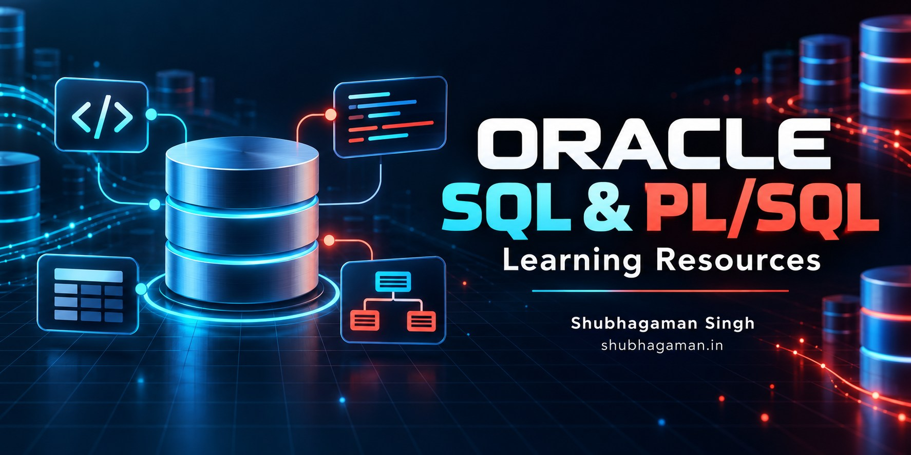

<div align="center">



# Oracle SQL & PL/SQL Learning Resources

### Learn databases by reading, running, breaking, and fixing real SQL.

Beginner-friendly notes, corrected examples, practical labs, interview preparation, and hands-on exercises for **Oracle SQL**, **SQL\*Plus**, and **PL/SQL**.

[](LICENSE.md)


[Start learning](#-learning-roadmap) · [Practice labs](dbtask/README.md) · [Interview questions](Database-textbook/interview.md) · [Quick reference](Database-textbook/syntax.md) · [Online practice](https://www.sql-practice.com/)

Created and maintained by **[Shubhagaman Singh](https://shubhagaman.in)**<br>
[Website](https://shubhagaman.in) · [Email](mailto:shubhagamansingh@gmail.com) · [GitHub repository](https://github.com/ShubhagamanSingh/learning_SQL_Oracle)

</div>

---

The material began as personal classroom transcripts from 2021. It has been reorganized for learners, corrected where necessary, and enriched with explanations and runnable examples. The original `.txt` files remain beside the Markdown lessons as a historical archive.

## ✨ Why this repository?

| 📘 Structured learning | 🧪 Hands-on practice | 🧠 Interview preparation | ✅ Corrected examples |
|---|---|---|---|
| Concepts progress from DBMS basics to PL/SQL. | Six classroom-style labs build practical confidence. | Twenty-five DBMS, SQL, and PL/SQL questions have complete answers. | Historical mistakes are explained and replaced with runnable solutions. |

## 🗺️ Learning roadmap

Follow the lessons in order if you are new to relational databases.

| Step | Module | You will learn |
|---:|---|---|
| 01 | [Database and SQL fundamentals](Database-textbook/Database.md) | DBMS concepts, users, SQL categories, DDL, DML, DCL, and TCL |
| 02 | [Oracle SQL\*Plus workbook](Database-textbook/Connection.md) | Connecting, creating tables, CRUD operations, transactions, and joins |
| 03 | [SQL quick reference](Database-textbook/syntax.md) | Frequently used Oracle SQL and PL/SQL syntax in one place |
| 04 | [Views, constraints, keys, and CTAS](Database-textbook/VIEW.md) | Views, validation, composite keys, and table creation from queries |
| 05 | [PL/SQL fundamentals](Database-textbook/PLSQL/PLSQL.md) | Blocks, variables, conditions, loops, SQL integration, and exceptions |
| 06 | [PL/SQL worked examples](Database-textbook/PLSQL/PLSQL_CODE.md) | Calculator, even/odd, input handling, and defensive programming |
| 07 | [Interview questions with answers](Database-textbook/interview.md) | Twenty-five corrected interview-ready questions and answers |
| 08 | [Six-day practical lab](dbtask/README.md) | A progressive lab covering tables, queries, constraints, and PL/SQL |

```text
Database basics → Oracle SQL → Joins & constraints → Views → PL/SQL → Practice → Interview review
```

## 🚀 Quick start

Clone the repository:

```console
git clone git@github.com:ShubhagamanSingh/learning_SQL_Oracle.git
cd learning_SQL_Oracle
```

Then begin with [Database and SQL fundamentals](Database-textbook/Database.md), or open the [practical lab](dbtask/README.md) if you prefer learning by doing.

> [!TIP]
> ### 🌐 Ready to write queries now?
> Open **[SQL Practice](https://www.sql-practice.com/)** for an interactive browser-based SQL terminal, guided questions, and automatic result checking—no local setup required.

<div align="center">

[](https://www.sql-practice.com/)

</div>

## 📁 Repository map

```text
.
├── .github/assets/            # Repository and social-preview artwork
├── Database-textbook/
│   ├── README.md               # Topic index
│   ├── Database.md             # DBMS and SQL foundations
│   ├── Connection.md           # SQL*Plus setup and guided SQL workbook
│   ├── syntax.md               # Compact SQL/PLSQL reference
│   ├── VIEW.md                 # Views, CHECK constraints, keys, CTAS
│   ├── interview.md            # 25 answered interview questions
│   └── PLSQL/                  # PL/SQL lessons and programs
└── dbtask/
    ├── README.md               # Practical-lab index
    ├── day1.md ... day6.md     # Daily exercises
    └── CW_18-12-2021.md        # Banking classwork
```

## 🎯 What you will learn

- Relational-database and DBMS fundamentals
- Oracle data types and table design
- `CREATE`, `ALTER`, `DROP`, and `TRUNCATE`
- `INSERT`, `SELECT`, `UPDATE`, and `DELETE`
- Filtering, sorting, pattern matching, and aggregate functions
- Primary, foreign, unique, composite, and check constraints
- Inner and outer joins, views, subqueries, and CTAS
- Transactions with `COMMIT`, `ROLLBACK`, and savepoints
- PL/SQL blocks, variables, branches, loops, and exceptions
- Common interview questions and practical problem solving

## 🛠️ Requirements

- Oracle Database (the original sessions used Oracle Database 11g Express Edition)
- SQL\*Plus, SQLcl, or Oracle SQL Developer
- A practice account with permission to create tables and views

> [!CAUTION]
> Do not use `SYS`, `SYSTEM`, or the broad `DBA` role for routine learning exercises. Ask an administrator to create a practice user with only the privileges required for the lesson.

For SQL\*Plus examples that use `DBMS_OUTPUT`, enable output first:

```sql
SET SERVEROUTPUT ON;
```

Examples containing `&name` use SQL\*Plus substitution variables and will prompt for a value.

## 🧭 Conventions used in these notes

- SQL keywords are uppercase for readability; Oracle treats unquoted identifiers case-insensitively.
- `VARCHAR2` is used rather than `VARCHAR`, following common Oracle practice.
- Inserts name their target columns whenever that makes the example safer.
- `COMMIT` and `ROLLBACK` are shown deliberately so transaction boundaries are visible.
- Placeholder forms such as `<table_name>` are templates, not literal SQL.
- Corrected code is preferred in the Markdown lesson; the adjacent `.txt` file preserves the original classroom record.

## 🧪 How to use the exercises

Create a disposable practice schema, run one lesson at a time, predict each result before executing it, and then change the sample values. For destructive statements such as `DROP` and `TRUNCATE`, confirm that you are connected to the practice schema first.

### 🌐 Online SQL practice

Use **[SQL Practice](https://www.sql-practice.com/)** to run queries in your browser and work through interactive questions with automatic result validation. It is especially useful for practicing `SELECT`, `WHERE`, sorting, pattern matching, joins, aggregate functions, grouping, and subqueries without configuring a local database.

**Recommended workflow:** read a topic here → reproduce it in Oracle → reinforce the portable query concepts on **[SQL Practice](https://www.sql-practice.com/)**.

> [!IMPORTANT]
> SQL dialects differ. Treat the site as practice for portable SQL concepts, then verify Oracle-specific syntax in these notes or an Oracle environment. PL/SQL blocks, SQL\*Plus commands, Oracle data types, user administration, and some functions may not run unchanged in the online terminal.

## 🔍 Important corrections made during conversion

The Markdown edition fixes several easy-to-miss issues from the raw notes:

- joins now include the relationship between the tables, avoiding Cartesian products;
- Oracle syntax is used for dates and table renaming;
- composite keys are distinguished from candidate keys;
- the PL/SQL multiplication-table loop checks the counter rather than the input number;
- the maximum-of-three and electricity-bill programs cover all valid cases;
- the Fibonacci program prints exactly the requested number of terms;
- examples explain why repeated transaction runs can produce different results.

## 💡 Suggested practice

- Re-create every table without copying the answer.
- Add `NOT NULL`, `UNIQUE`, `CHECK`, primary-key, and foreign-key constraints with meaningful names.
- Wrap multi-step changes in a transaction and test both `COMMIT` and `ROLLBACK`.
- Rewrite old comma joins with explicit `JOIN ... ON` syntax.
- Extend the PL/SQL programs with input validation and exception handling.

## 🤝 Contributing

Corrections, clearer explanations, additional exercises, and Oracle-version notes are welcome. Before contributing, read [CONTRIBUTING.md](CONTRIBUTING.md) and follow the [Code of Conduct](CODE_OF_CONDUCT.md).

- Keep examples beginner-friendly and runnable.
- Explain destructive commands and transaction boundaries.
- Never include credentials, private data, or proprietary course material.
- Report sensitive problems privately according to [SECURITY.md](SECURITY.md).

## ⚖️ License, copyright, and policies

Copyright © 2021–2026 **Shubhagaman Singh**. Except where otherwise noted, the original educational material is licensed under [Creative Commons Attribution-NonCommercial-ShareAlike 4.0 International](LICENSE.md).

You may share and adapt the material for non-commercial purposes when you credit Shubhagaman Singh, link to <https://shubhagaman.in>, identify changes, and distribute adaptations under the same license.

See the [Legal and Policy Index](LEGAL.md) for copyright, terms, privacy, disclaimer, trademark, contribution, conduct, and security information.

---

<div align="center">

### Learn carefully. Query confidently. Share knowledge responsibly.

These notes are educational examples. Test them in a disposable schema before adapting them to a real system.

**[Shubhagaman Singh](https://shubhagaman.in)**<br>
[shubhagaman.in](https://shubhagaman.in) · [shubhagamansingh@gmail.com](mailto:shubhagamansingh@gmail.com)

[CC BY-NC-SA 4.0](LICENSE.md) · [Legal policies](LEGAL.md) · [Contributing](CONTRIBUTING.md) · [Security](SECURITY.md)

Copyright © 2021–2026 Shubhagaman Singh

</div>
